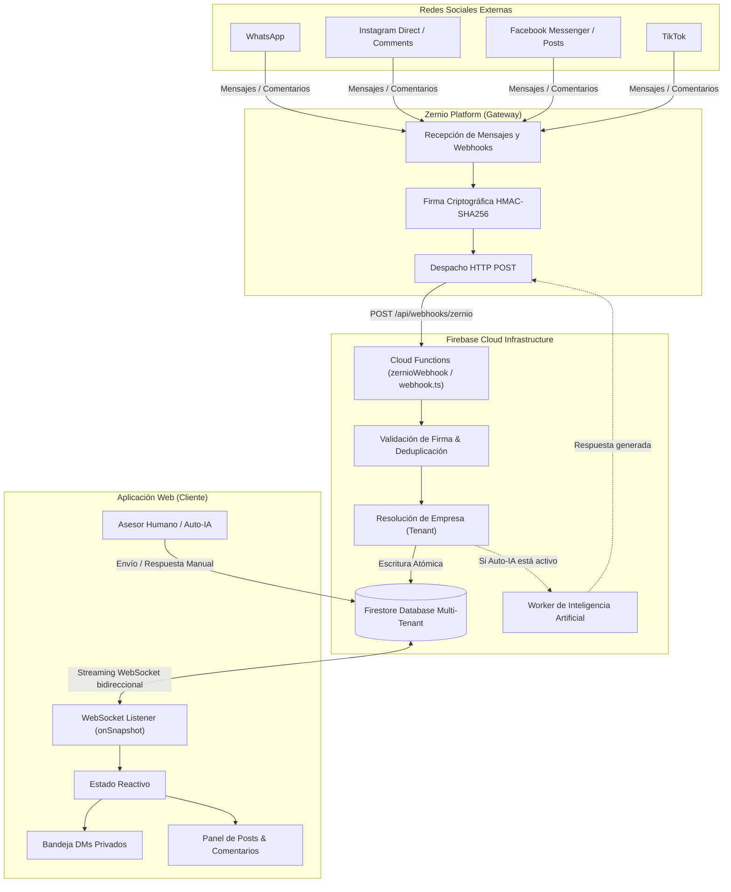
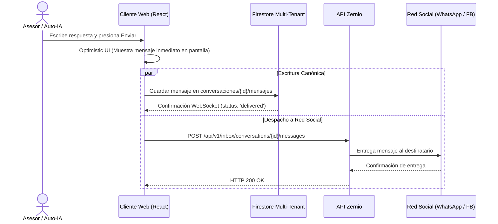

# Flujo Integral de Mensajería: Zernio &rarr; Firebase &rarr; Aplicación

Este documento detalla paso a paso la arquitectura técnica, el ciclo de vida y las estructuras de datos que gobiernan la recepción de mensajes y comentarios desde redes sociales a través de **Zernio**, su almacenamiento seguro en **Firebase Firestore** y su visualización reactiva en tiempo real (< 50 ms) en la aplicación.

---

## 1. Visión General de la Arquitectura



---

## 2. Fase 1: Entrada de Eventos desde Zernio

Cuando un cliente escribe un mensaje directo (DM) o comenta una publicación en una red social vinculada, Zernio procesa el evento y lo despacha como una solicitud `HTTP POST` hacia el endpoint registrado de Cloud Functions.

### 2.1. Encabezados de Seguridad HTTP
Zernio envía los siguientes encabezados para validar la autenticidad del origen:
* `X-Zernio-Signature`: Firma HMAC-SHA256 generada con el secreto del webhook (`webhookSecret`).
* `X-Zernio-Event-Id`: Identificador único del evento para garantizar idempotencia.
* `Content-Type`: `application/json`.

### 2.2. Tipos de Eventos Principales
* `message.received`: Mensajes entrantes de clientes (WhatsApp, Instagram Direct, Facebook Messenger).
* `comment.received`: Comentarios públicos realizados en publicaciones o reels de Facebook/Instagram.
* `message.sent`: Mensajes salientes emitidos por la empresa o página oficial.
* `post.published`: Notificación de publicación exitosa de contenido social.

### 2.3. Estructura del Payload (JSON)
```json
{
  "id": "evt_01JBMX84N9Z2A7V1",
  "event": "message.received",
  "profileId": "prof_6ae4fcb32d938859fd9b788e",
  "account": {
    "id": "acc_meta_98124",
    "platform": "whatsapp"
  },
  "message": {
    "id": "msg_ext_88192348",
    "conversationId": "conv_ext_10029",
    "direction": "incoming",
    "text": "Hola, ¿sigue disponible el departamento?",
    "sentAt": "2026-11-05T19:40:12Z",
    "sender": {
      "id": "user_wa_5215544332211",
      "name": "Carlos Mendoza",
      "avatar": "https://img.meta.com/profile/carlos.jpg"
    }
  }
}
```

---

## 3. Fase 2: Procesamiento y Blindaje en Cloud Functions

El backend procesa la solicitud entrante en `functions/src/webhook.ts`:

### 3.1. Validación de Firma Criptográfica
Se protege contra ataques de intermediario (*replay attacks*) validando la firma en tiempo constante:
```typescript
export function validSignature(rawBody: Buffer, signature: string | undefined, secret: string) {
  if (!signature) return false;
  const expected = Buffer.from(createHmac('sha256', secret).update(rawBody).digest('hex'));
  const given = Buffer.from(signature.trim().toLowerCase());
  return expected.length === given.length && timingSafeEqual(expected, given);
}
```

### 3.2. Idempotencia y Deduplicación
Para evitar procesar dos veces el mismo mensaje en caso de reintentos por caída de red de Zernio:
* El ID del mensaje (`platformMessageId` o `id`) se utiliza como clave de documento en Firestore.
* Si el documento ya existe, Firestore realiza una operación `merge: true`, evitando duplicación de registros o de respuestas automáticas de IA.

### 3.3. Resolución de la Empresa (Multi-Tenant Isolation)
El webhook mapea el `profileId` o `adminCustomId` de Zernio con la empresa correspondiente en la colección `empresas`:
```typescript
const empsSnap = await db.collection('empresas').get();
for (const empDoc of empsSnap.docs) {
  const data = empDoc.data();
  if (data.zernioProfileId === profileId) {
    empresaId = empDoc.id;
    break;
  }
}
```

---

## 4. Fase 3: Estructura Canónica en Firestore

Todos los datos se almacenan bajo la jerarquía estricta por empresa para garantizar aislamiento de datos (*Tenant Boundary*):

```text
empresas/
  └── {empresaId}/                          # Documento de la empresa (tenant)
        ├── identidades/                    # Customer Identity Graph
        │     └── {channel}_{identifier}   # Mapeo rápido a cliente canónico
        ├── clientes/                       # Perfil unificado del cliente
        │     └── {customerId}
        ├── posts_sociales/                 # Catálogo de posts sociales
        │     └── {postId}                  # Autor, contenido, permalink, likeCount, commentCount
        └── conversaciones/                 # Hilos de interacción
              └── {conversationId}/         # DMs (zernio_...) o Posts (conv_...)
                    └── mensajes/           # Subcolección de mensajes o comentarios
                          └── {messageId}   # Contenido, emisor, fecha, estado
```

### 4.1. Esquema del Documento de Conversación
Ruta: `empresas/{empresaId}/conversaciones/{conversationId}`
```json
{
  "id": "zernio_chat_98123",
  "tenantId": "company_inmuebles_ultra",
  "empresaId": "company_inmuebles_ultra",
  "channel": "whatsapp",
  "channelType": "dm",
  "channelThreadId": "chat_98123",
  "accountId": "acc_meta_98124",
  "customerId": "cust_wa_5215544332211",
  "customerName": "Carlos Mendoza",
  "customerAvatar": "https://...",
  "lastMessageSnippet": "Hola, ¿sigue disponible el departamento?",
  "lastMessageAt": 1793907612000,
  "lastMessageSender": "customer",
  "status": "open",
  "unreadCount": 1,
  "updatedAt": 1793907612000
}
```

### 4.2. Esquema del Mensaje Individual
Ruta: `empresas/{empresaId}/conversaciones/{conversationId}/mensajes/{messageId}`
```json
{
  "id": "msg_ext_88192348",
  "conversationId": "zernio_chat_98123",
  "tenantId": "company_inmuebles_ultra",
  "channel": "whatsapp",
  "sender": "customer",
  "senderName": "Carlos Mendoza",
  "senderAvatar": "https://...",
  "content": "Hola, ¿sigue disponible el departamento?",
  "status": "delivered",
  "createdAt": 1793907612000
}
```

### 4.3. Separación Estricta: DMs Privados vs Comentarios de Posts
* **DMs Privados (`channelType: 'dm'`):**
  Identificadores como `zernio_...` o `thr_out_...`. Aparecen exclusivamente en la bandeja de **DMs Privados**.
* **Comentarios de Posts (`channelType: 'post_comment'`):**
  Identificadores prefijados con `conv_{postId}`. Se excluyen de la bandeja de mensajes privados y se visualizan en la vista de **Posts**. Solo se convierten en tickets de DM si un operador presiona **"Atender en Inbox &rarr;"** (generando un ticket `cmt_{commentId}`).

---

## 5. Fase 4: Despliegue en Tiempo Real en la Aplicación Web

Para evitar saturar la API de Zernio con peticiones HTTP repetitivas (y eliminar el error `429 Too Many Requests`), el cliente web utiliza **WebSockets nativos de Firestore** mediante `onSnapshot`.

### 5.1. Conexión WebSocket para Conversaciones de Inbox
En `src/App.tsx`, el listener escucha en tiempo real cualquier cambio en los hilos:
```typescript
const unsub = subscribeToTenantConversations(tenantKey, 35, (firestoreConvs) => {
  // Filtro de canal: aísla los DMs de los comentarios de publicaciones
  const dmConvs = firestoreConvs.filter(
    (fc) => !fc.id.startsWith('conv_') && fc.channelType !== 'post_comment'
  );
  setThreads(dmConvs);
});
```

### 5.2. Conexión WebSocket para el Chat Abierto (Streaming de Mensajes)
Al seleccionar un hilo, se suscribe de inmediato a su subcolección de mensajes:
```typescript
const unsub = subscribeToTenantThreadMessages(tenantKey, selectedThreadId, 50, (firestoreMsgs) => {
  setThreads((prev) =>
    prev.map((t) => (t.id === selectedThreadId ? { ...t, messages: firestoreMsgs } : t))
  );
});
```
> [!NOTE]
> Cuando el cliente escribe desde WhatsApp o Facebook, Firestore propaga el cambio en **menos de 50 milisegundos**. El mensaje aparece en la pantalla del asesor instantáneamente sin requerir que el usuario recargue la página.

### 5.3. Visualización Instantánea de Posts (Carga 0 ms)
En lugar de solicitar la lista de publicaciones a Zernio en cada apertura:
```typescript
const unsub = subscribeToTenantSocialPosts(tenantKey, (firestorePosts) => {
  if (firestorePosts.length > 0) {
    setPosts(firestorePosts);
  }
});
```
Si Zernio está en enfriamiento o el operador pierde conexión temporalmente, la aplicación muestra inmediatamente los posts y comentarios desde la caché local/Firestore sin interrupciones.

---

## 6. Fase 5: Ciclo de Respuesta (Saliente)

Cuando el asesor responde o el motor de IA auto-responde:



### 6.1. Blindaje con Circuit Breaker (`429 Cooldown`)
Si la API de Zernio alcanza su límite de peticiones:
1. `zernioService.ts` detecta el código `429 Too Many Requests`.
2. Activa un enfriamiento de 45 segundos (`markZernioRateLimited(45)`).
3. Todas las lecturas y escrituras continúan operando transparentemente sobre **Firestore**, evitando bloqueos en la interfaz de usuario.

---

## 7. Resumen de Componentes Involucrados

| Componente | Archivo | Responsabilidad |
|---|---|---|
| **Webhook Handler** | `functions/src/webhook.ts` | Valida HMAC, deduplica eventos y guarda en Firestore. |
| **Sincronización Multi-Tenant** | `src/services/tenantSyncService.ts` | Métodos `subscribeToTenantConversations`, `subscribeToTenantSocialPosts`, etc. |
| **Cliente Zernio** | `src/services/zernioService.ts` | Despacho de mensajes y comentarios salientes con circuit breaker 429. |
| **Bandeja de Entrada** | `src/components/inbox/StreamPane.tsx` | Lista reactiva de hilos DMs filtrados por canal y estado. |
| **Panel de Comentarios** | `src/components/inbox/PostCommentsPane.tsx` | Agrupación de comentarios por persona, auto-respuesta y escalado a DM. |

